# Shudhana

An all-in-one study app for exams: quizzes (multiple choice and short answer), flashcards on FSRS, free recall checklists, and a practice log for hands-on work, all on one calendar. Built with Tauri 2, Svelte 5 and Rust (SQLite). Your data lives on your own computers, and an account to sync is optional on the desktop.

## Screenshots

*Taken from the demo profile (see [Try it with demo data](#try-it-with-demo-data)).*

**Overview:** what's due today, your accuracy, how many right answers were guesses, your score per quiz, why you got things wrong, and your weakest topics first.

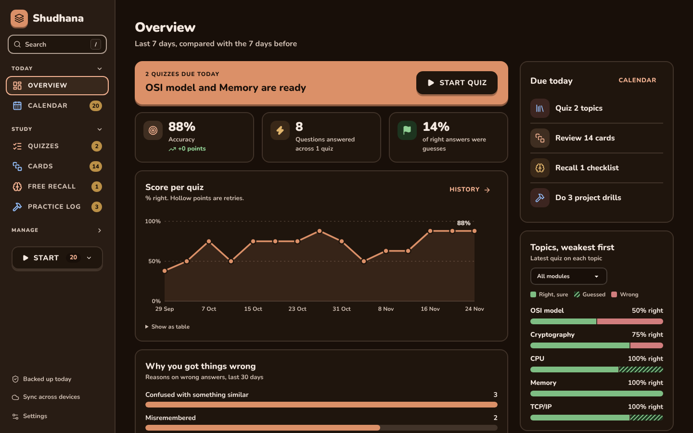

**Quizzes:** one quiz per topic, grouped by module. Each topic shows how often it repeats and when it's next due, and you can tick a few to quiz them together.

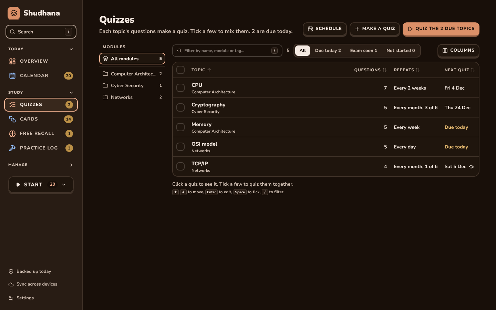

**After a quiz:** wrong and guessed answers first, each with its explanation and a "why did you get it wrong?" picker, plus where every topic now sits on its quiz schedule.

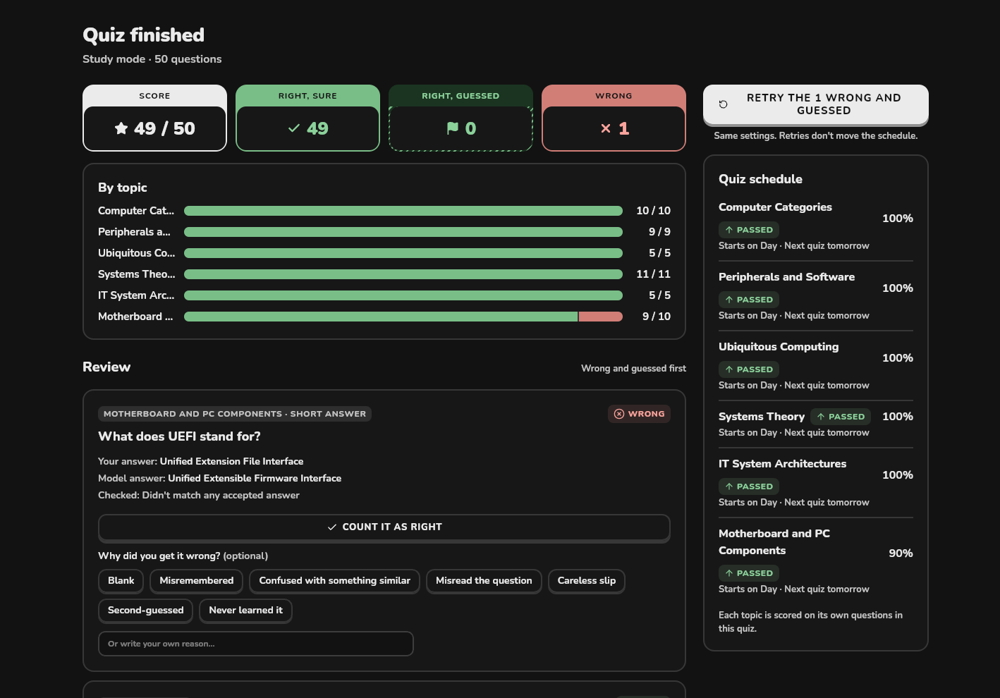

**Suggestions:** questions you got wrong (and recall points you missed) are offered as cards. Nothing becomes a card until you say so.

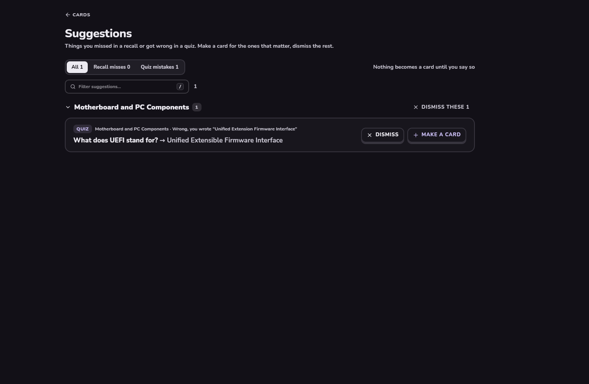

**Card review:** every card shows its topic on the front, so you know the context before you answer.

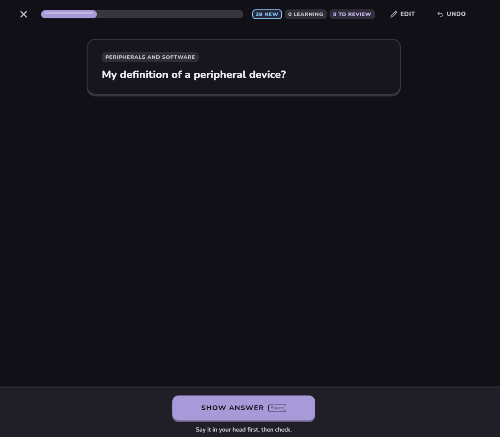

**Cards:** today's review, the next 14 days and your retention, with Browse all a tab away so today's answers stay hidden.

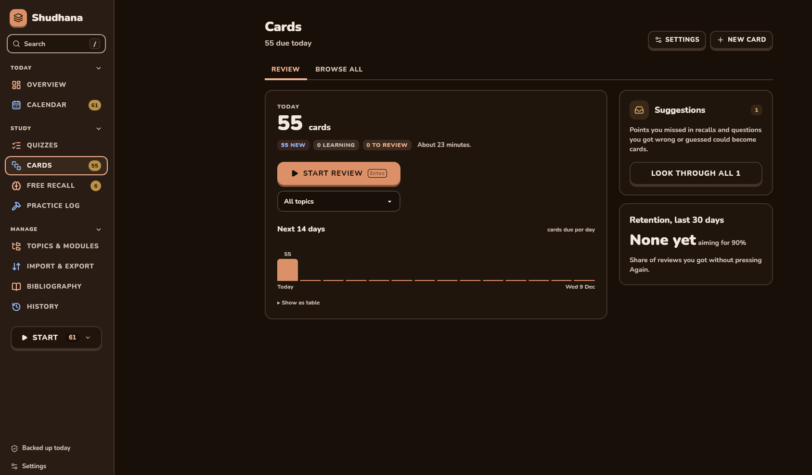

**Writing cards:** basic, reversed or cloze, with a live preview, several cues for one answer, Markdown, code, maths and images.

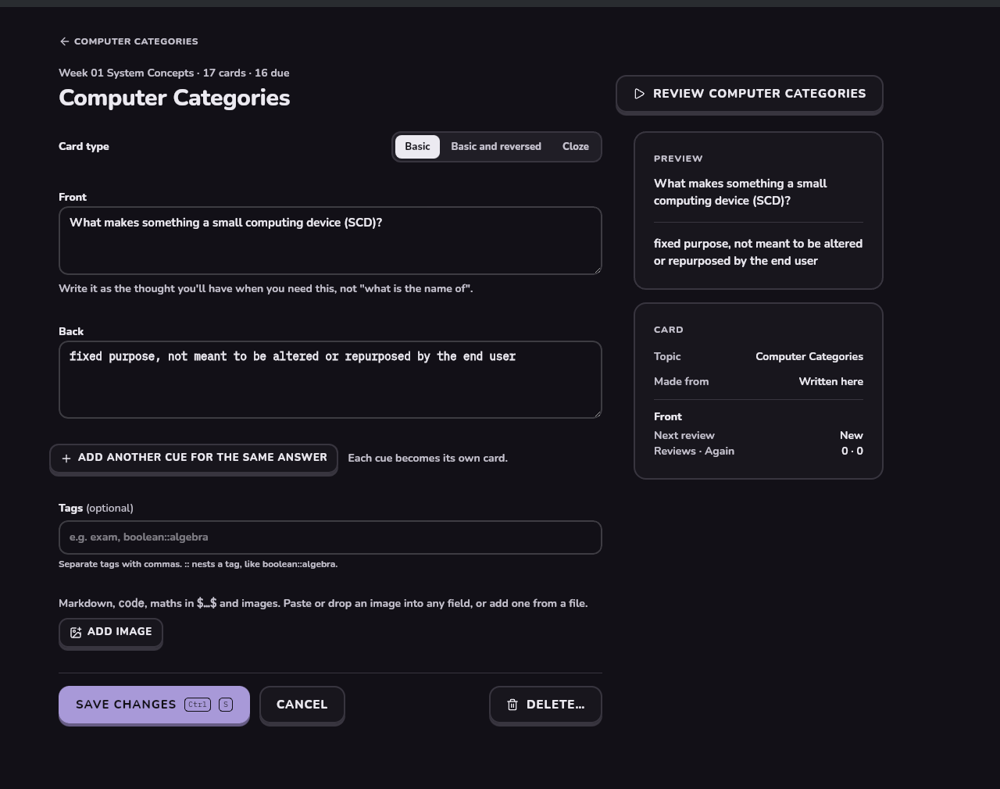

**Free recall:** a checklist of points for a topic or module. Recall everything you can, tick what you got, and the score decides when the next check is and whether it moves up the schedule.

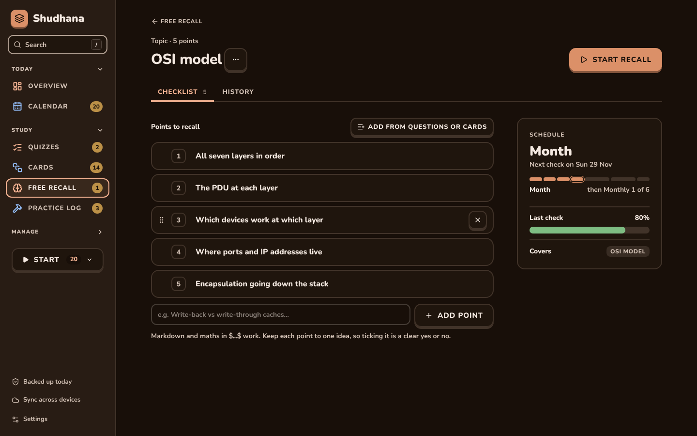

**Practice log:** what tripped you up while coding or doing a past paper, with why it wasn't obvious. Things you couldn't recall become suggested cards, and things you couldn't apply become drills.

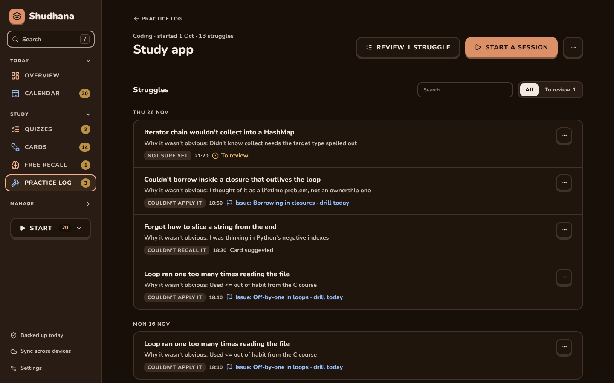

**Calendar:** everything due each day, what you did on past days, and exam dates that bring reviews round sooner.

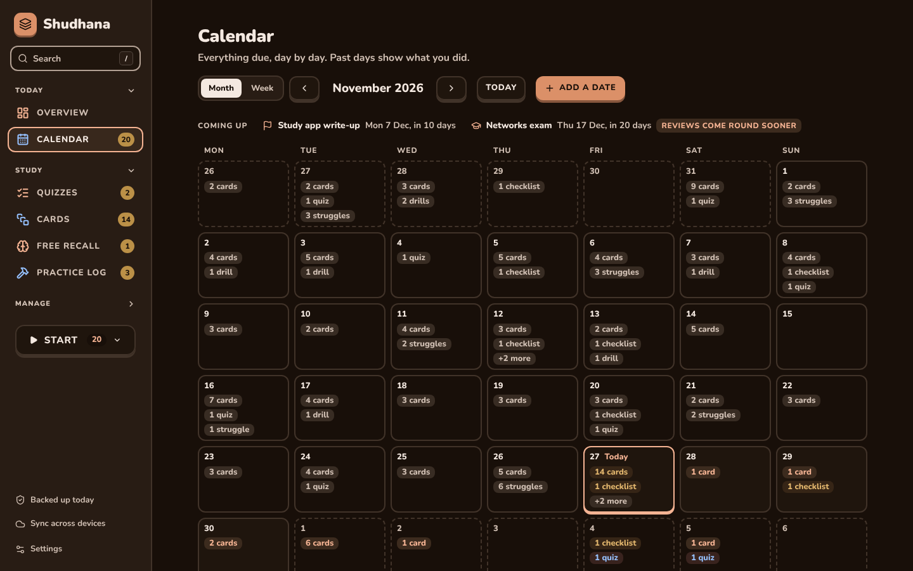

**Themes:** nine colour themes in light and dark, each with a colour-blind safe right and wrong.

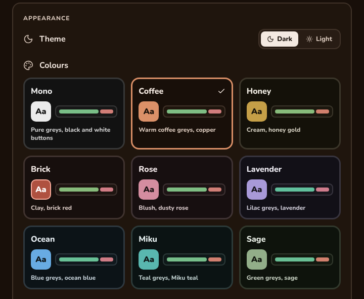

**On a phone:** the same app in the browser, with the main screens in a dock along the bottom.

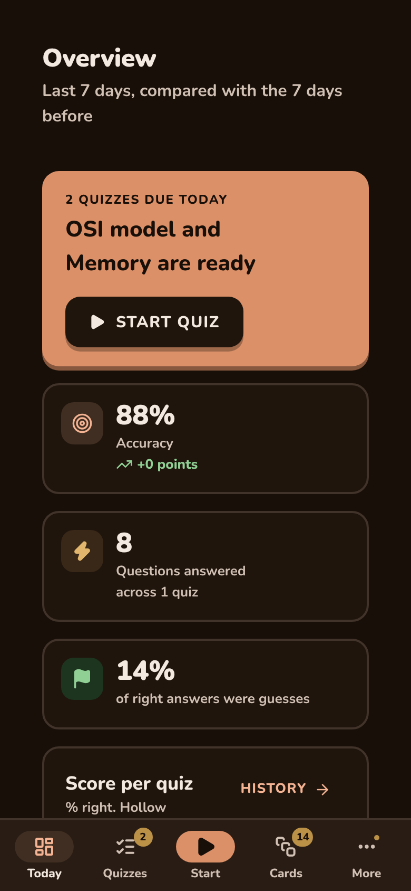

## What's in it

- **Overview:** what's due today, accuracy, how many right answers were guesses, score per quiz, the reasons you gave for wrong answers, and your weakest topics.
- **Quizzes:** each topic's questions make a quiz. Tick a few to mix them. Write questions with your slides, PDFs, Word files or EPUBs open beside you, and note which source each fact came from. Each topic climbs a quiz schedule, with a daily share of quizzes when a lot fall due at once. Questions and options are shuffled by default. Study mode shows the answer after each question. Exam mode lets you move back and forth and change answers until you press Finish. Press E to fix a question mid-quiz and carry on. After answering, you can flag a right answer as a guess, and wrong answers ask why you got them wrong.
- **Cards:** basic, reversed and cloze flashcards scheduled with FSRS. Cards opens on today's review, and Browse all lists every card with search and filters (answers of cards due today stay hidden). Before a review you see how it will go: learning, reviews and new cards in groups (or all mixed), in an order you can change, with cards you miss coming back at the end of the session or a set number of cards later. During a review, E edits a card, A adds one, Ctrl+Delete deletes it (with undo), and Ctrl+Z undoes a grade. Missed quiz questions and recall points become suggested cards, never added without asking.
- **Free Recall:** checklists about a module or a topic. Write or say everything you remember, tick what you got, and the next check is scheduled from how you did.
- **Practice Log:** note what trips you up while coding, doing a past paper or anything hands-on, review it at the end of the session, and turn it into cards or drills.
- **Calendar:** everything due, plus exam dates that can tighten reviews before them.
- **Manage:** Topics & Modules, Import & Export (Anki decks, spreadsheets, JSON, Markdown, GIFT, Aiken), Bibliography and History.
- **Search** across everything, from the sidebar or with `/`.
- Nine colour themes, light and dark, each with a colour-blind safe right and wrong. Daily backups, and sync through any shared folder or an optional account.
- **Phone version:** a browser build for phones, iPhone included, which syncs through an account (see [Phone version](#phone-version)).

## Install

Grab the latest release from [Releases](https://github.com/ArthurChenEvans/study-app/releases):

| System | File |
|---|---|
| Fedora, openSUSE and other RPM distros | `shudhana-<version>.x86_64.rpm` |
| Debian, Ubuntu, Mint | `shudhana_<version>_amd64.deb` |
| Any other Linux (or if a package misbehaves) | `shudhana-<version>-x86_64.AppImage` |
| Windows, portable (no install, data stays in its folder) | `shudhana-<version>-windows-portable.zip` |
| Void Linux (glibc) | `shudhana-<version>_1.x86_64.xbps` |
| Windows | `shudhana-<version>-setup.exe` |
| macOS (Apple silicon and Intel) | `shudhana-<version>-universal.dmg` |

Installed copies update themselves, except on Void, where xbps does it. To install or update the .xbps, put it in a folder on its own and run, from that folder:

```bash
xbps-rindex -a *.xbps
sudo xbps-install --repository="$PWD" -Su shudhana
```

xbps pulls in WebKitGTK and the other libraries it needs from the Void repos. The Mac app isn't notarised, so the first time you open it, go to System Settings, Privacy & Security, and press Open Anyway.

## Run it from source

```bash
pnpm install
pnpm tauri dev       # opens the app
```

You need Rust, Node with pnpm, and WebKitGTK 4.1 (`webkit2gtk4.1-devel` on Fedora, `libwebkit2gtk-4.1-dev` on Debian). LibreOffice is optional, for PowerPoint previews. On NixOS, `nix develop` gives you all of it.

## Try it with demo data

`study-web` runs the same app in a browser, and can fill a database with a demo profile:
5 topics across 3 modules, MCQ and short answer questions with sources, and 60 days of
quizzes, recall checks and card reviews (including cards flagged to rewrite and a late
checklist), plus three projects with sessions, struggles, shared issues and drills, so the
calendar, quiz schedules and today's drills all have something in them.

### In a container

```bash
podman compose up --build -d   # http://localhost:7392, seeded on the first start
podman compose down            # stop, keep the database
podman compose down -v         # stop and delete the database, the next up seeds again
```

Set `STUDY_SEED: "0"` in `compose.yaml` to start empty. `STUDY_SEED=large podman compose up -d`
(after a `down -v`) seeds a heavy profile instead: about 170 topics in 14 modules, thousands of
questions and cards and four months of history, for checking how screens cope with a lot of data.
Outside a container that's `study-web seed <database> --large`. PowerPoint previews need
`SLIDES: "1"` there, which adds LibreOffice to the image (much bigger). Docker works the same.
It's on port 7392, only open to this computer since there are no logins. If that's taken,
`STUDY_PORT=7400 podman compose up -d` uses another. Outside a container, `STUDY_ADDRESS=127.0.0.1:7400` does the same.

### Without a container (inside `nix develop`)

```bash
# Desktop app on a throwaway seeded database
export XDG_DATA_HOME=$(mktemp -d)
cargo run -p study-web -- seed "$XDG_DATA_HOME/com.arthurchenevans.studyapp/study.sqlite"
pnpm tauri dev

# Or the browser version with hot reload: the server on :7392, Vite on :5173
STUDY_DB=$(mktemp -d)/study.sqlite STUDY_SEED=1 cargo run -p study-web &
pnpm dev
```

The browser and desktop versions each have their own database. They don't sync.

## Backups

The app backs itself up once a day (once there's something in it), and before a restore or an update that upgrades the database. Backups are full copies, named like `study 2026-11-04 09-12 daily.sqlite`, in:

- **Desktop:** `~/.local/share/com.arthurchenevans.studyapp/backups`
- **Browser version:** `backups` next to its database, so `/data/backups` in the container's volume (`down -v` deletes them too). `STUDY_BACKUPS` points it somewhere else.

"Your data" (from Settings, or the backup line at the bottom of the sidebar) lists them, backs up by hand, restores, sets how many to keep (7 days, 4 weeks and 12 months to start with) and can copy every backup to a second folder, like a USB stick. Each backup is an ordinary SQLite file, so you can also copy one into place by hand while the app is closed.

Every record has an ID that's the same on every computer, a "last changed" stamp and, once deleted, a marker. The database's triggers fill these in using functions the app provides, so other SQLite tools can read the database but can't add or change rows in it.

## Import and export

Import & Export (under Manage in the sidebar) exports everything, or some topics to share, as one `.studyapp` file: a zip of readable JSON (`manifest.json`, `data/topics.jsonl` and so on) plus the images, so the data is never locked inside the app. The desktop app saves it to your Downloads folder, and the browser version downloads it.

Importing shows what's new, what's here already and what's changed in both places before anything changes, then makes a backup and adds it all at once. Records are matched by ID, so importing a newer version of a shared file updates it instead of copying it. History is only ever added, and nothing here is deleted.

It also reads Anki decks and collections (`.apkg`, `.colpkg`, old or new format, with images, maths and optionally Anki's progress, filtered by tag and with suspended cards left out or kept paused), spreadsheets (`.csv`, `.tsv`), JSON, Markdown, GIFT and Aiken. It exports to an Anki deck, a spreadsheet, JSON, Markdown, GIFT or Aiken too. You can also drop a file anywhere on the window. The last import can be undone.

## Sync

"Your data" can keep computers (and the browser version) in step through any folder another app keeps the same on each one: Syncthing (free, no account), Nextcloud, a network drive, or a USB stick you carry. Pick the folder, name the computer, then pick the same folder on the other one. There's no server and nothing to pay for.

The database never goes in the folder, since syncing a live SQLite file corrupts it. Each computer appends its changes to its own files (`devices/<id>.json` and `changes/<id>/<month>.jsonl`), so no file ever has two writers. The app reads the others' files when it starts, every 30 seconds while it's open, and on "Sync now". Edits are merged field by field. When the same field changed on two computers before they saw each other's change, the newer one is used and the pair is listed under "things to check", where the other version can be put back. A delete loses to a change made elsewhere before that computer saw it, so nothing is lost by accident. Restoring a backup pauses sync.

The browser version joins by mounting the same folder in `compose.yaml` (see the comment there) and typing its path in the set-up dialog.

## Install

### Nix (NixOS)

```sh
nix --extra-experimental-features "nix-command flakes" build
./result/bin/study-app
```

Or add it to your system flake: `inputs.study-app.url = "github:ArthurChenEvans/study-app";` and put `study-app.packages.x86_64-linux.default` in `environment.systemPackages`. LibreOffice comes with it for PowerPoint previews.

The first build stops with a hash mismatch for the pnpm dependencies. Copy the `got: sha256-...` value into `hash =` in `flake.nix` and build again. Do the same whenever `pnpm-lock.yaml` changes.

### AppImage (other distros)

```sh
nix develop --extra-experimental-features "nix-command flakes"
pnpm install
pnpm tauri build --bundles appimage
```

The file lands in `target/release/bundle/appimage/`. On NixOS run it with `nix run nixpkgs#appimage-run -- "Shudhana_0.1.0_amd64.AppImage"`. PowerPoint previews need LibreOffice installed on the system, since it isn't bundled.

## Tests

```bash
scripts/test-all.sh          # everything, about 10 minutes
scripts/test-all.sh --quick  # skips the steps that need a release build, about 3 minutes
```

Or the parts on their own:

```bash
cargo test           # domain, storage, command layer and the web server
pnpm test            # Svelte screens (Vitest)
```

What the robustness tests cover (added by the November 2026 audit):

| Test | What it guards |
|---|---|
| `crates/study-web/tests/commands_fuzz.rs` | Every command with hostile arguments and with a wrong clock: none may panic or hang |
| `crates/study-api/src/audit_tests.rs` | Damaged imports, sync folders and backups, a quiz surviving a restart, backup settings, slide conversion, two copies on one database |
| `crates/study-store/src/upgrade_tests.rs` | Upgrading from every older schema version with rows in every table |
| `crates/study-core/tests/scheduling_properties.rs` | Properties of the ladders, FSRS, tightening and drills (proptest) |
| `crates/study-web/tests/http.rs` | Other websites can't call the browser version, security headers, the desktop policy |
| `crates/study-web/tests/perf.rs` | Every screen's commands on three years of seeded use, against time budgets |
| `scripts/kill-tests.py` | `kill -9` while saving and while upgrading, then SQLite's integrity and foreign key checks |
| `src/lib/*.security.test.ts`, `links.test.ts` | What rendered text and EPUB pages can't do, EPUB size limits, links never navigating the app |

## Layout

| Path | What it is |
|---|---|
| `specs/` | Requirements (R1 to R191) and Gherkin feature files |
| `docs/design-rules.md` | Design system: tokens, type, colour, charts, both themes |
| `design/` | Clickable HTML prototype of every screen |
| `crates/study-core` | Domain rules, no IO |
| `crates/study-store` | SQLite storage and search |
| `crates/study-api` | Everything the app's commands do, as testable functions |
| `src-tauri` | Desktop shell, forwards commands to study-api |
| `src` | Svelte frontend |
| `crates/study-web` | The browser version's server, the demo seeder and the robustness tests |
| `e2e/` | Tests and a UI sweep that drive the real app window |
| `.github/workflows` | Release builds (.rpm, .deb, .xbps, .exe, .dmg) and the package check on pull requests |

## End-to-end tests

Drive the real app window through tauri-driver, on a fresh throwaway database:

- `e2e/slides_test.py` converts a slide deck over the same IPC the preview uses
- `e2e/rich_content_test.py` writes a question with a pasted image, a picked image and highlighted code, then takes a quiz on it and checks the images decode and the code is coloured in both themes
- `e2e/sweep.py` opens every screen at desktop, tablet and phone widths in both themes, empty and with a large seeded profile, and checks contrast, tap target sizes, layout spill and accessibility (axe). `SCREENS=cards,quizzes` limits it to some screens

```sh
cargo install tauri-driver   # once; also needs WebKitWebDriver from webkitgtk and python selenium
e2e/run.sh                   # builds a debug app, then runs both (starts Xvfb if there's no display)
```


## Accounts and sync (Supabase)

Accounts are optional on the desktop (the phone version needs one). Signed in, the app syncs through a free Supabase project. Setting one up:

1. Make a Supabase project. Put its URL and publishable key in `crates/study-api/src/cloud.rs` (`PROJECT_URL`, `PUBLISHABLE_KEY`). Both are safe in the app. Never put the service_role key anywhere in the repo.
2. In the SQL Editor, run each file in `supabase/migrations` in order. They make the tables, switch on Row Level Security for every table (and any made later), and add the delete-my-account and clear-my-sync functions.
3. Authentication, Sign In / Providers, Email: keep email on and "Confirm email" on, set Email OTP Expiration to 600.
4. Authentication, Emails: put `{{ .Token }}` in both the Magic Link and the Confirm signup templates (a new email gets the second), so they send a code, not a link. Set up custom SMTP (a Gmail address with an app password works for a small group).
5. Authentication, Rate Limits: keep emails per hour low (around 30). Authentication, Multi-Factor: turn on TOTP.
6. To make yourself admin, sign in once, then in the Table Editor add your user's id (from Authentication, Users) to the `admins` table.


## Phone version

A browser build for phones (iPhone included), published to GitHub Pages from `main` by
`.github/workflows/phone.yml`. It needs an account: the study core runs in a worker
(`crates/study-phone`, compiled to WebAssembly), keeps its database in the browser, and syncs
with Supabase.

- One-time setup: repository Settings, Pages, Source: **GitHub Actions**.
- Address: `https://<user>.github.io/study-app/`. On an iPhone, open it in Safari, then Share, Add to Home Screen.
- On a phone the less-used review and quiz actions sit in a "…" menu, and you can turn on shake to undo in Settings (the phone asks for motion access the first time).
- Build it yourself with `./scripts/phone-build.sh` (needs the `wasm32-unknown-unknown` target and wasm-pack).
